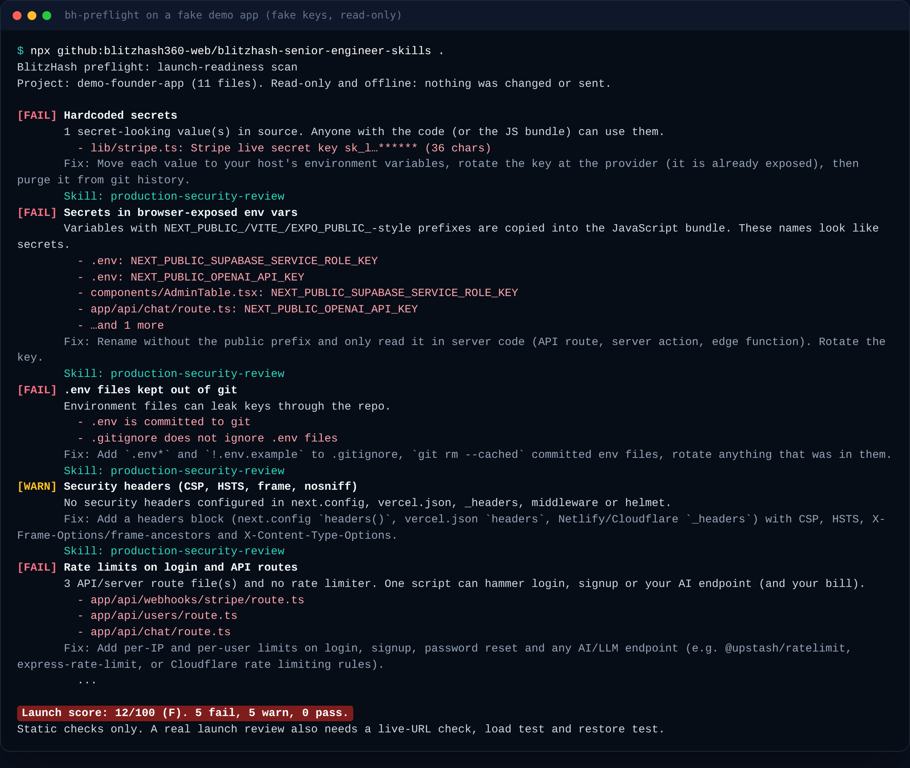
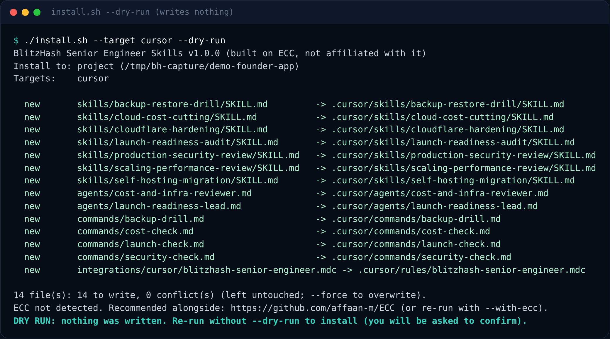

# BlitzHash Senior Engineer Skills

**Give Cursor, Claude Code, Codex, Qoder or Antigravity the production checklist a senior engineer runs before launch: security, scale, cloud cost, Cloudflare, self-hosting and backups. Built on [ECC](https://github.com/affaan-m/ECC).**

[](LICENSE)
[](https://github.com/blitzhash360-web/blitzhash-senior-engineer-skills/actions/workflows/ci.yml)
[](https://github.com/affaan-m/ECC)
[](https://agentskills.io)
[](https://github.com/blitzhash360-web/blitzhash-senior-engineer-skills/stargazers)

Seven production skills, two reviewer agents and four slash commands for founders shipping apps built with Lovable, Bolt, Replit, Cursor or v0, plus `bh-preflight`, a read-only scanner that scores your project out of 100 before real users arrive. Install them alongside ECC (or on their own) with one script that shows every file before it writes anything.


<sub>`bh-preflight` on a fake demo app (`npm run demo`). The keys are fake and the scan never leaves your machine.</sub>

## Quick start (3 steps)

```bash
# 1. Get it (Node 18.17+ and bash, no dependencies)
git clone https://github.com/blitzhash360-web/blitzhash-senior-engineer-skills && cd blitzhash-senior-engineer-skills

# 2. See exactly what would be installed into your project (writes nothing)
./install.sh --target cursor --project ~/code/my-app --dry-run

# 3. Install, then ask your agent: "Run a launch-readiness audit on this project."
./install.sh --target cursor --project ~/code/my-app
```

Targets: `claude`, `cursor`, `codex`, `qoder`, `antigravity`, `agents-md` (any IDE that reads `AGENTS.md`), or `all`. Add `--global` to install for your user instead of one project, and `--with-ecc` to also run ECC's official installer.

Just want the score? Run the scanner on any project folder, no install needed:

```bash
npx -y github:blitzhash360-web/blitzhash-senior-engineer-skills ~/code/my-app
```

## What each skill does

| Skill | What it does | Slash command |
|---|---|---|
| `launch-readiness-audit` | Runs `bh-preflight`, asks what a scan cannot see (staging, restores, spend caps), and returns **Fix before launch / Fix this month / Nice to have / Not checked**, then fixes one item at a time. | `/launch-check` |
| `production-security-review` | Leaked keys (source and git history), secrets behind `NEXT_PUBLIC_`/`VITE_`, Supabase `service_role` in the browser, auth on every API route, Stripe webhook signatures, security headers, CORS, rate limits. Plans key rotation with you. | `/security-check` |
| `scaling-performance-review` | Measures first (Lighthouse, endpoint timings, slow queries), then N+1 queries, missing indexes, unbounded selects, connection pooling, streaming and queued AI calls, bundle size, caching. Load tests only on staging, with permission. | |
| `cloud-cost-cutting` | Reads your own usage exports for Vercel, Netlify, Supabase, Firebase, Railway, Render, AWS and AI APIs. Finds idle projects, oversized plans, function and bandwidth waste, runaway AI spend. Spend caps and alerts first. | `/cost-check` |
| `cloudflare-hardening` | SSL Full (strict), HTTPS, TLS 1.2+, WAF rules for `/.env` and `/.git` probes, rate limits, Turnstile, hiding the origin IP, DNSSEC. Uses our [Cloudflare skills CLI](https://github.com/blitzhash360-web/blitzhash-cloudflare-production-skills) with a scoped token. | |
| `self-hosting-migration` | Decides with numbers whether a VPS or Docker setup pays off, then hardens the server, sets up TLS, backups and monitoring, and plans a staged cutover with rollback. | |
| `backup-restore-drill` | Inventories what is backed up, restores a fresh dump into a scratch database (never production), times it, and writes `docs/backup-restore.md`. | `/backup-drill` |

Agents: `launch-readiness-lead` (runs the whole review and delegates to the skills) and `cost-and-infra-reviewer` (bills, edge, backups, self-hosting).

### bh-preflight checks

Hardcoded secrets (Stripe, OpenAI, Anthropic, AWS, GitHub, Google, Slack, Resend, private keys, database URLs with passwords) · secret-looking names behind public env prefixes · `.env` committed or not ignored · security headers · rate limiting · auth checks on API routes · Stripe webhook signature verification · wildcard CORS · error monitoring · backup and restore runbook · build hygiene (public source maps, lockfile, logging secrets). `--json` and `--fail-under 70` work in CI.

## Where the installer puts things

| Target | Skills | Agents | Commands | Extra |
|---|---|---|---|---|
| Claude Code | `.claude/skills/` | `.claude/agents/` | `.claude/commands/` | |
| Cursor | `.cursor/skills/` | `.cursor/agents/` | `.cursor/commands/` | `.cursor/rules/blitzhash-senior-engineer.mdc` |
| Codex | `.agents/skills/` | | `~/.codex/prompts/` (with `--global`) | `AGENTS.md` block |
| Qoder | `.qoder/skills/` | `.qoder/agents/` | `.qoder/commands/` | |
| Antigravity | `.agents/skills/` | `.agents/agents/` | `.agents/workflows/` | |
| Any `AGENTS.md` IDE | `.agents/skills/` | | | `AGENTS.md` block |

With `--global` the same folders are used under your home directory (Claude Code, Cursor, Codex, Qoder).



## Safety model

- **Read-only first, dry run before every change, apply only after your explicit "yes".** Every skill says so, and CI fails if one does not.
- **Scoped tokens from your own environment.** Agents never ask for keys in chat, never print them (first 4 characters at most) and never commit them.
- **The installer never overwrites files it did not create**, refuses to write in a non-interactive shell without `--yes`, and `--uninstall` removes only its own files and its own `AGENTS.md` block.
- **`bh-preflight` only reads files.** No writes, no network, no telemetry.

Details in [docs/SAFETY.md](docs/SAFETY.md).

## Built on ECC

[ECC](https://github.com/affaan-m/ECC) is a large MIT-licensed skills, agents and hooks system for AI coding tools. This pack is built on ECC and made for ECC users: it uses the same `SKILL.md` and agent formats, installs into the same folders without touching ECC's files, and each skill hands deeper engineering work to the matching ECC skill or agent (for example `security-review`, `security-reviewer`, `performance-optimizer`, `postgres-patterns`, `docker-patterns`). It also works without ECC. See [docs/ECC.md](docs/ECC.md).

This is an independent BlitzHash project. It is not part of ECC and not affiliated with or endorsed by its author.

## Going to production? What this doesn't cover

These skills catch the common, expensive mistakes. A production launch for a real business usually also needs:

- **A live-URL and penetration test** by a person: auth flows, IDOR, business-logic abuse, not just static patterns.
- **Database access rules reviewed table by table** (Supabase RLS policies, storage bucket policies) with two real test accounts.
- **Load testing on staging** with realistic traffic, plus a plan for the AI provider being slow or down.
- **Incident runbooks**: who gets paged, how to roll back a deploy, how to rotate every key in an hour.
- **Monitoring and alerting** tuned so real problems page someone and noise does not.
- **A cost model at 10x users**, with spend caps on every provider.
- **A restore drill on the real production backups**, timed, with the result written down.
- **Compliance basics** if you hold personal, health or payment data (privacy policy, data retention, processor agreements).

Want a senior team to look at yours? Get a free assessment at **[blitzhash.com](https://blitzhash.com)**.

## Development

```bash
npm test            # scanner tests + validator tests + installer end-to-end tests (temp folders only)
npm run validate    # SKILL.md frontmatter, sections, safety wording, banned claims, secret-shaped strings
npm run demo        # scan a fake risky app and a fixed copy
npx markdownlint-cli2
```

```text
skills/<name>/SKILL.md     7 skills (frontmatter: name, description, license, metadata)
agents/*.md                2 reviewer agents
commands/*.md              4 slash commands
install.sh                 installer for Claude Code, Cursor, Codex, Qoder, Antigravity, AGENTS.md IDEs
bin/bh-preflight.mjs       read-only launch-readiness scanner (lib/preflight.mjs)
examples/                  fake demo app generator + demo
scripts/validate-skills.mjs  skill linter used in CI
```

## Credits

- [ECC](https://github.com/affaan-m/ECC) by Affaan Mustafa (MIT). The skill, agent and command formats and the per-tool folder layout follow ECC's conventions, and the skills reference ECC skills by name. No ECC files are copied into this repo.
- Skill format follows the open [Agent Skills](https://agentskills.io) `SKILL.md` convention.
- Tool folder locations from the official docs of Claude Code, Cursor, Codex, [Qoder](https://docs.qoder.com/cli/Skills) and ECC's [Antigravity guide](https://github.com/affaan-m/ECC/blob/main/docs/ANTIGRAVITY-GUIDE.md).

Product names (Claude Code, Cursor, Codex, Qoder, Antigravity, Lovable, Bolt, Replit, v0, Supabase, Vercel, Stripe, Cloudflare) are trademarks of their owners and are used only to describe compatibility.

## License

MIT © BlitzHash. See [LICENSE](LICENSE).

---

Built by BlitzHash: need a senior team to check or scale your AI-built app? Free assessment at https://blitzhash.com
